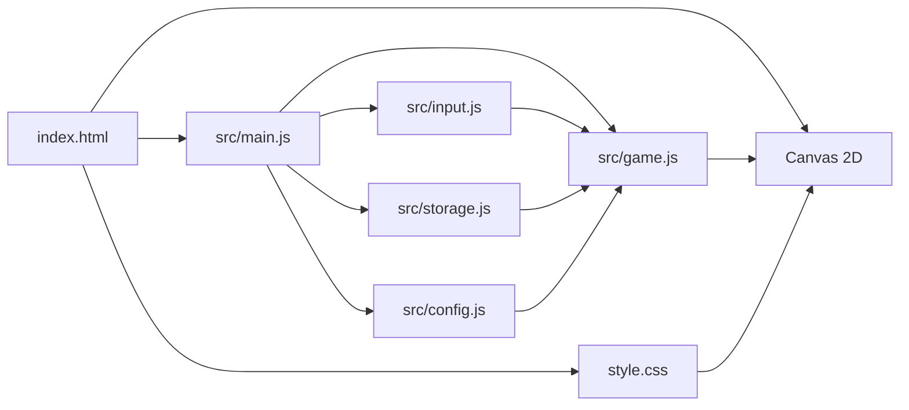
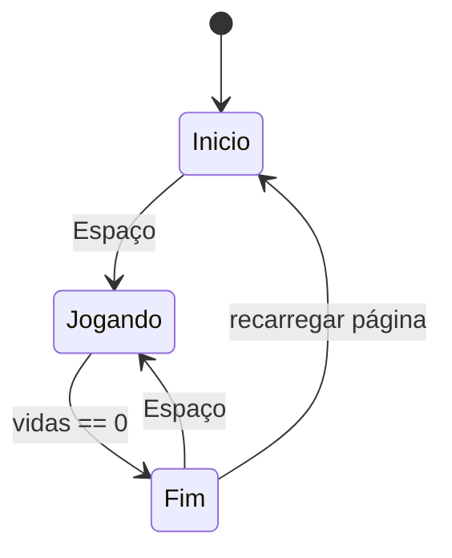

# Design: Chuva de Bugs

## Visão geral
O jogo será uma página simples com um canvas central e um estado mínimo de três telas: início, jogando e fim. A lógica principal ficará em um módulo de jogo, enquanto o teclado e o armazenamento local ficam separados para facilitar manutenção e permitir testes simples. O fluxo será baseado em um loop de animação com delta time em segundos, usando o Canvas 2D para desenhar o dev, os itens e os textos. A geração inicial terá intervalos menores, e o aumento gradual da dificuldade será mais lento. Coletar ou perder cafés alterará a velocidade do dev, respeitando limites configurados. O HUD e as telas de estado terão hierarquia visual clara e se adaptarão a janelas estreitas. O recorde fica salvo no navegador por meio de localStorage.

## Decisões técnicas
| Decisão | Escolha | Por quê |
|---|---|---|
| Entrada | Teclado apenas | Mantém o comportamento esperado pelos requisitos e reduz ambiguidades em controles. |
| Persistência | `localStorage` | Garante recorde local sem backend e funciona em GitHub Pages. |
| Estrutura | 6 arquivos com responsabilidades bem separadas | Mantém o projeto simples e compatível com a meta de 15 minutos. |
| Renderização | Canvas 2D com emojis | Funciona com HTML/JS puros e atende ao estilo do projeto. |
| Estado | Máquina de estados simples | Permite iniciar, jogar e terminar sem criar lógica complexa. |

## Arquitetura


## Estrutura de arquivos
```text
.
├── index.html                 # Página principal que monta a tela e o canvas.
├── style.css                 # Layout da página, centralização e visual do jogo.
├── src/
│   ├── config.js             # Constantes do jogo e valores de ajuste fino.
│   ├── input.js              # Leitura do teclado e sinalização de ações válidas.
│   ├── game.js               # Estado do jogo, loop, geração de itens e colisões.
│   ├── storage.js            # Leitura e gravação do recorde em localStorage.
│   └── main.js               # Inicialização do jogo e encadeamento dos módulos.
└── specs/
    ├── requirements.md       # Requisitos do sistema.
    └── design.md             # Decisões técnicas e arquitetura deste projeto.
```

## Componentes
### `index.html`: Estrutura da página
- **Responsabilidade:** Montar a área do jogo, o canvas e a marcação do nome do jogo.
- **Estado:** Sem estado de jogo; somente a estrutura visual da página.
- **Funções principais:** `initGame()`: chama a inicialização do módulo principal; `renderHud()`: opcional em HTML, se houver textos na página.
- **Atende:** 1.1, 1.3, 5.3, 8.2, 8.3

### `style.css`: Estilo visual
- **Responsabilidade:** Organizar a hierarquia visual do título, da área de jogo e do HUD, além de adaptar o layout a janelas estreitas.
- **Estado:** Propriedades visuais estáticas, sem variáveis de jogo.
- **Funções principais:** `body {}`: define a página; `.game-shell {}`: organiza o conteúdo; `canvas {}`: mantém a área de jogo legível e responsiva.
- **Atende:** 1.1, 1.3, 5.3, 8.2, 8.3

### `src/config.js`: Configuração central
- **Responsabilidade:** Guardar as constantes ajustáveis do jogo em um único objeto `CONFIG`.
- **Estado:** Apenas valores fixos e exportados.
- **Funções principais:** `createConfig()`: retorna o objeto de configuração; `export const CONFIG = { ... }`: centraliza os parâmetros.
- **Atende:** 2.3, 3.1, 4.1, 4.2, 5.1, 7.1, 7.2, 7.3, 7.4

### `src/input.js`: Leitura do teclado
- **Responsabilidade:** Mapear teclas de movimento e Espaço para o estado do jogo.
- **Estado:** `keys.left`, `keys.right`, `keys.space` e sinalização de eventos de teclado.
- **Funções principais:** `setupInput()`: registra listeners; `isLeftPressed()`: consulta movimento; `isStartPressed()`: consulta acionamento de início ou reinício.
- **Atende:** 1.2, 2.1, 2.2, 2.4, 5.4

### `src/game.js`: Lógica principal do jogo
- **Responsabilidade:** Controlar estados, gerar itens, mover o personagem, processar colisões, atualizar pontuação, vidas e velocidade do dev e desenhar a área de jogo e seu HUD.
- **Estado:** `state`, `player.speed`, `items`, `score`, `lives`, `record`, `difficultyTimer`.
- **Funções principais:** `createGame()`: define o estado inicial; `update(dt)`: avançar a simulação; `draw()`: renderizar; `spawnItem()`: criar café ou bug; `handleCollisions()`: resolver coleta e dano; `endGame()`: transição para tela final.
- **Atende:** 1.2, 1.3, 2.1, 2.2, 2.3, 3.1, 3.2, 3.3, 3.4, 4.1, 4.2, 4.3, 5.1, 5.2, 5.3, 5.4, 6.1, 6.3, 6.4, 7.1, 7.2, 7.3, 7.4, 8.1, 8.2

### `src/storage.js`: Persistência local
- **Responsabilidade:** Salvar e recuperar o recorde em `localStorage`.
- **Estado:** Chave do armazenamento e valor atual do recorde.
- **Funções principais:** `loadRecord()`: lê a pontuação guardada; `saveRecord(value)`: grava o novo recorde; `updateRecordIfNeeded(score)`: compara e persiste quando necessário.
- **Atende:** 6.1, 6.2, 6.3, 6.4

### `src/main.js`: Inicialização e orquestração
- **Responsabilidade:** Conectar os módulos, iniciar o loop principal e decidir a tela atual conforme o estado do jogo.
- **Estado:** Instância do jogo, estado global e referências aos módulos.
- **Funções principais:** `init()`: configura input, storage e canvas; `loop(time)`: chama `update` e `draw`; `setState(nextState)`: alterna entre início, jogando e fim.
- **Atende:** 1.1, 1.2, 1.3, 5.2, 5.4, 6.2

## Configuração central (`CONFIG` em `src/config.js`)
| Constante | Valor inicial | Para que serve | Atende |
|---|---:|---|---|
| `canvasWidth` | 640 | Largura da área de jogo | 2.3 |
| `canvasHeight` | 480 | Altura da área de jogo | 2.3, 3.4 |
| `hudHeight` | 96 | Altura reservada para o HUD, fora da área de queda | 8.1 |
| `playerSpeed` | 320 | Velocidade horizontal do dev | 2.1, 2.2 |
| `playerSpeedMin` | 200 | Limite mínimo de velocidade do dev | 7.4 |
| `playerSpeedMax` | 420 | Limite máximo de velocidade do dev | 7.2, 7.4 |
| `coffeeSpeedIncrease` | 20 | Aumento de velocidade ao coletar café | 7.2 |
| `missedCoffeeSpeedDecrease` | 30 | Redução de velocidade por café perdido | 7.3 |
| `startLives` | 3 | Quantidade inicial de vidas | 5.1 |
| `coffeePoints` | 1 | Pontos ganhos por café | 3.2 |
| `bugDamage` | 1 | Dano causado por bug | 3.3, 5.2 |
| `itemSpawnStart` | 0.4 | Espera inicial antes do primeiro item | 3.1 |
| `spawnIntervalMin` | 0.5 | Menor intervalo entre itens | 4.1, 7.1 |
| `spawnIntervalMax` | 1.1 | Maior intervalo inicial entre itens | 4.1, 7.1 |
| `difficultySpawnReduction` | 0.01 | Redução gradual do intervalo de geração ao longo do tempo | 4.1 |
| `itemSpeedMin` | 110 | Velocidade mínima inicial de queda | 4.2 |
| `itemSpeedMax` | 170 | Velocidade máxima inicial de queda | 4.2 |
| `difficultySpeedBoost` | 4 | Aumento gradual da velocidade de queda pelo tempo | 4.2, 4.3 |
| `difficultyGrowth` | 0.04 | Fator de crescimento gradual da dificuldade | 4.3 |
| `recordStorageKey` | "bugRainRecord" | Nome da chave em localStorage | 6.1, 6.2 |

## Fluxo


Passo a passo do loop principal:
1. A página carrega e a tela inicial é mostrada. O módulo `main.js` cria o estado do jogo e ativa a leitura de teclado.
2. Quando a tecla Espaço é pressionada, `input.js` sinaliza um início de partida e `game.js` muda de `Inicio` para `Jogando`.
3. No estado de jogo, `game.js` gera itens aleatórios no topo da tela, move o dev conforme as setas/A-D e faz a queda dos cafés e bugs em tempo real.
4. O sistema verifica colisões com o dev, aplica pontos ou dano e remove objetivos que atingem o chão sem efeito.
5. A frequência inicial de geração é maior que na configuração anterior; durante a partida, os intervalos diminuem e a velocidade de queda aumenta gradualmente, com taxas controladas por `CONFIG`.
6. Ao coletar um café, o dev ganha velocidade; ao deixar um café cair, perde velocidade. Em ambos os casos, a velocidade permanece entre os limites de `CONFIG`.
7. Quando o jogador perde a última vida, a partida entra em `Fim`, exibe a pontuação final e o recorde salvo e aguarda outra tecla Espaço para reiniciar.

## Propriedades de corretude
- Para qualquer quadro, o dev fica dentro dos limites horizontais da área de jogo. (Valida: 2.3)
- Ao coletar um café, a velocidade do dev aumenta sem ultrapassar o limite máximo; ao perder um café, diminui sem ficar abaixo do limite mínimo. (Valida: 7.2, 7.3, 7.4)
- Durante a partida, a geração respeita os intervalos configurados e começa com frequência maior que a configuração anterior. (Valida: 7.1)
- Para qualquer item gerado, ele cai apenas do topo e não desaparece sem regra definida. (Valida: 3.1, 3.4)
- Para qualquer colisão entre café e dev, o sistema soma exatamente 1 ponto e remove o item. (Valida: 3.2)
- Para qualquer colisão entre bug e dev, o sistema reduz exatamente 1 vida e remove o item. (Valida: 3.3)
- Para qualquer pontuação maior que o recorde salvo, o recorde local é atualizado e persistido. (Valida: 6.1, 6.2)
- Para qualquer estado de jogo, a dificuldade nunca volta para trás enquanto a partida continua ativa. (Valida: 4.3)
- Durante a partida, o HUD mostra pontuação, recorde, vidas e velocidade sem encobrir o dev ou os itens. (Valida: 8.1)
- Em janelas estreitas, a área de jogo e seus textos permanecem visíveis sem rolagem horizontal. (Valida: 8.3)

## Casos limite
- O jogador pressiona teclas de movimento antes da partida começar: o sistema ignora movimento e mantém o estado em início.
- O jogador pressiona Espaço repetidamente na tela inicial: o jogo só deve iniciar uma vez por pressão válida de início.
- O recorde não existe no navegador: `storage.js` deve usar valor inicial 0 e aceitar a primeira pontuação.
- O jogador perde a última vida: `game.js` deve encerrar a partida sem continuar a geração de itens.
- O item cai parcialmente fora da área: a regra de remoção por chão deve prevalecer antes de qualquer outro cálculo.
